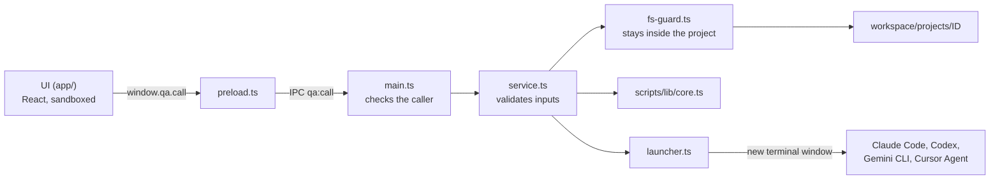

# Desktop app — architecture

The Quality Agents desktop app is a thin visual layer over the framework. It has **no AI of its own**: it shows the project files, lets the QA read and edit them, and opens the AI tool the QA already uses with the request ready. Skills, workflows and project context stay plain files that any AI tool can use without the app.

## Pieces

| Path | Role |
|---|---|
| `scripts/qa.ts` | The `qa` command: opens the app (default), the terminal menu (`--terminal`) or prepares a request directly (`--project … --tool …`) |
| `desktop/main.ts` | Electron main process: one window, one validated IPC channel, project folder watcher |
| `desktop/preload.ts` | Bridge exposed to the UI as `window.qa` (`call`, `watch`, `onChanged`, `openLink`) |
| `desktop/service.ts` | Everything the UI can ask for: projects, file tree, read/write files, activity state, inbox, launching AI tools. Validates every input |
| `desktop/fs-guard.ts` | Path confinement (`resolveInside`) and file type rules (editable, openable) |
| `desktop/launcher.ts` | Opens AI tools: terminal tools in a new terminal window, editors with the request on the clipboard |
| `desktop/run-tool.ts` | Runs in that new window (Windows): reads the request from a UTF-8 JSON file and starts the tool |
| `scripts/lib/core.ts` | Shared core (also used by the terminal menu): projects, runs, skills, request building |
| `scripts/lib/docx.ts` | Word (`.docx`) to Markdown, so any AI can read stories written in Word |
| `scripts/lib/markdown.mjs` | Markdown to HTML (escapes all HTML from the document); also used for PDF reports |
| `app/` | UI (React + TypeScript, built by Vite into `app/dist/`): start screen, Obsidian-like workspace, launch dialog |



## Security model

- **Renderer locked down**: `contextIsolation`, `sandbox`, no Node integration, strict Content-Security-Policy, no navigation, no new windows (web links go to the default browser), all permission requests denied.
- **One IPC channel** (`qa:call`) that only accepts calls from the app's own page and only the service's method names.
- **Every input validated in the main process**: project ids must exist; paths are resolved inside the project folder (symlinks included); activities, tools and languages come from fixed lists; inbox files must exist.
- **Editing** only for existing `.md` and `.txt` files. **Opening with the default program** only for document and image types — never executables or scripts.
- **AI tools** are started from the fixed tool list. User text only travels as the prompt: on Windows through a UTF-8 file (never through a batch file); on macOS/Linux as a single-quoted argument.
- **Markdown** is rendered with all HTML escaped (including attribute quotes); links are handled by the app, not followed by the page.

## Build and run

```bash
npm run setup      # install + build (also after each git pull)
npm run app:build  # build only: Vite (UI) + esbuild (main, preload, run-tool) into app/dist and app/dist-electron
npm run app:dev    # build and open the app
qa                 # open the app (after npm link)
```

Both build folders are ignored by Git.

Development helpers (environment variables of the main process):

| Variable | Effect |
|---|---|
| `QA_OPEN_PROJECT=<id>` | Opens that project directly |
| `QA_SCREENSHOT=<file.png>` | Saves a screenshot of the window and quits (visual checks) |

## Tests

`tests/desktop.test.ts` exercises the service without Electron: project creation, file tree, reading and editing, path confinement, launch validation, Word extraction, Markdown escaping and the launcher's quoting. AI tools are never started in tests.

## Planned

- Windows installer (`.exe`) with the app icon and Start-menu/desktop shortcuts.
- Approvals and context proposals as buttons in the side panel.
